# UC-STU-01 - Dated appointment architecture

## Boundaries

Flask authenticates users, checks ownership and coordinates PostgreSQL transactions.
The C++ appointment scheduling service owns interval feasibility and deterministic
recommendations. It receives an independent versioned JSON operation through the
verified engine executable. Existing `--json` allocation protocol v1, weekly
`TimeSlot`, room strategies and standalone CSV CLI remain unchanged.

[Diagram source](appointments-components.mmd) and the [complete database ER diagram](database-er-physical.svg)
show the implemented boundaries and schema additions.

Professor actors use the existing Instructor role. Login accounts reference
university users; account administration is a separate explicit grant, not a
client-selected role. The legacy demonstration/technical dashboard is restricted
to administrative accounts. Appointment records are visible only to their
organizer, selected professors and invited students; free/busy responses do not
disclose personal event titles or third-party schedules.

## Student home read model

`StudentDashboardService` reads the authenticated student's summaries and timetable
in one read-only, repeatable-read PostgreSQL transaction. The student
blueprint owns navigation; it does not invoke the engine or decide availability.
Counts distinguish upcoming organizer-owned confirmed bookings, pending requests
and optional invitations. A next-meeting card may include a nondeclined optional
invitation, but it is never counted as the student's mandatory reservation.
Calendar projection reuses explicit legacy bindings and displays unresolved
applicability as a warning, not as free time. Bounded card lists link to the
existing appointment/detail/calendar workflows. Professor and administrator
landing pages, schema and scheduling protocol remain unchanged.

`PersonalScheduleService` provides the same private timetable for all university
roles. Month selection defaults to university-local today, with week links,
Monday-Friday columns and hourly rows containing exact event times. Multi-hour
events continue into later cells; overlapping optional invitations stay visible.
Weekend commitments remain in a separate list. Event records, not rendered grids,
are authoritative in PostgreSQL; no per-user duplicate schedule table is created.
Own university titles can be shown by the calendar projection, without adding
presentation fields to engine input. Course enrollment cannot be inferred from
resource attendee counts.

The booking form has separate searchable multi-selects and one date. A single-day
query uses the existing appointment protocol's optional limit of 100, sufficient
for its 15-minute recommendation grid; legacy range queries retain their default.
Input changes invalidate selected times and obsolete browser responses. A manual
time on the same date remains supported and receives the same C++ validation.
Submission rejects a time on another date and confirmation still rechecks all
mandatory participants. Known fictional name suffixes are display-only; database
names, identifiers and login accounts are unchanged.

## Calendar semantics

University timezone defaults explicitly to `Europe/Istanbul`, configurable using
`RESOURCE_ALLOCATION_TIMEZONE`. Dated instants are timezone-aware and persisted in
UTC. Intervals are half-open `[start, end)`, so adjacent meetings do not conflict.
Local wall times that are ambiguous or nonexistent are rejected rather than guessed.

Professor office-hour patterns require weekday, minute interval, explicit valid-from
and valid-until dates, recorded timezone and excluded dates. Personal/professor
blocks and confirmed appointments are dated intervals. Only known required human
participants count as university commitments; an examination's anonymous seat
count is not a student enrollment roster.

Legacy weekly records stay undated. An administrator can bind individual busy slots
or resource requests to an explicitly entered academic period, choosing weekly
recurrence or a specified planning week and recording exceptions. No automatic
backfill, inferred semester or permanent repetition is allowed. Unbound commitments
for mandatory participants produce `UNRESOLVED_CALENDAR`; optional invitees with
unknown applicability do not block feasibility but are not reported as known-free.

## Persistence design

Additive migrations introduce login accounts, academic periods, legacy calendar
bindings, professor availability, dated blocks, appointments, required-professor
decisions, student invitations, confirmed mandatory-person commitments and
appointment events. Existing application tables remain intact. Appointment
revision/state/time constraints and per-person overlap protection supplement
transactional validation; no room-overlap constraint changes exam sharing.

Input-changing calendar operations coordinate through the existing state row and
a calendar revision. Appointment C++ evaluation occurs on a coherent snapshot;
commit checks its revision and appointment revision under lock. Confirmation
stores mandatory commitments atomically; cancellation releases them atomically.
Room allocation publication must not invalidate confirmed dated commitments.

## Lifecycle and recommendations

States are Pending Approval, Declined, Confirmed and Cancelled. All required
professors must approve the same revision. A proposed-time change clears approvals.
Pending requests reserve nothing. Professor rejection prevents confirmation;
organizer/selected-professor cancellation records an event and releases reservations.
Invitations start unanswered and can decline without cancelling the appointment.
Participant-facing history/status informs affected users without email infrastructure.

C++ first checks published professor intervals, dated blocks, applicable legacy
commitments, organizer/required-professor conflicts and duration. It then ranks
feasible candidates by known-free invited students, distance from the organizer's
preferred time and chronological tie-breaking. Manual proposals use the same
feasibility check; recommendations never override mandatory constraints.

## Delivery and verification

Implementation proceeds through authentication, additive schema, dated C++
protocol, calendar expansion, lifecycle/concurrency, frontend, schedule integration
and full verification. Tests cover all four participant configurations, explicit
calendar validity/exceptions, unknown legacy applicability, timezone/date boundaries,
unanimous revision-specific approvals, optional declines, cancellation, concurrent
confirmation, privacy/CSRF and existing allocation/JSON regressions. Final ER
diagrams and the academic iteration report reflect the verified implementation.

## Operational scope

Accounts are provisioned by a trusted utility for existing university identities;
there is no public self-registration or role selection. Application status/history
and invitation pages provide in-application notifications, not email delivery.
Calendar setup requires actual known periods and typed faculty/department membership;
no production data is automatically changed. Published-hours removal conservatively
requires resolving the professor's future confirmed appointments first. Search is
bounded to 32 days and 20 returned recommendations by default; valid manual proposals
remain supported. Future enrollment integrations could supply identities unavailable
from anonymous resource attendee counts, without guessing current students' schedules.
