# Iteration 41 - PostgreSQL application persistence

## Boundary and authority

PostgreSQL replaces operational CSV inputs, config.txt, and the published local
engine-result.json. Flask application services own transactions. The existing
C++17 engine, EngineGateway, executable verification, and JSON protocol v1 remain
unchanged. CSV is an explicit import/export or standalone CLI compatibility tool,
not a database fallback or a second writable application store.

## ER diagrams and physical inventory



- [High-level Mermaid source](database-er-high-level.mmd): principal entities, using only actual foreign-key relationships.
- [Complete physical ER diagram](database-er-physical.svg) and [Mermaid source](database-er-physical.mmd): all 18 application tables plus Alembic's existing infrastructure table, every column, PK, FK and relationship.
- [Physical schema catalog](database-schema-catalog.md): every column's type/nullability/default, composite keys, unique/check constraints, indexes and deletion policy.

`alembic_version` is the nineteenth physical table, used only by Alembic, not an
application entity. Application sources/catalog are generated from the models;
the existing Alembic revision marker is explicitly documented too. Use
`python scripts/generate_database_diagrams.py`; `--check` detects drift in tests/CI.
SVGs are rendered with Mermaid CLI 12.0.0 and remain zoomable. For example:

```text
mmdc -i docs/architecture/database-er-physical.mmd -o docs/architecture/database-er-physical.svg -t neutral -b white
```

Mermaid-safe labels such as `varchar_32` mean SQL `varchar(32)`; the catalog uses
exact PostgreSQL type names.

Cardinalities describe physical constraints: a request can temporarily have zero
slot rows in direct SQL, although application transactions require at least one.
An exam-details row belongs to exactly one request; a request has at most one.
The optional parent/primary-unit/run FKs allow unknown organizational hierarchy
and pre-publication state. A run may be inactive; only the singleton state selects
the active run. Composite allocation/suggestion FKs cannot cross run boundaries.

## Tables

| Table | Important columns and relationships |
|---|---|
| role | Integer PK; unique name. Primary engine roles remain Student, TeachingAssistant, Staff, Instructor, Administrator. Assigned role labels are preserved, not new priority policies. |
| organization_unit | Integer PK; unique name; nullable type and self-referencing parent FK. Unknown hierarchy/type remains unknown instead of inferred from display names. |
| university_user | Integer PK; primary role FK and nullable primary unit FK; name, email, status and current profile fields. No password or authentication is introduced in this iteration. |
| user_role | Composite user/role PK; assignment ordinal. Preserves assignedRoles order. |
| resource | Integer PK; unique source ordinal; type, name, capacity, building, three feature booleans and availability. |
| resource_request | Integer PK; generated submission ordinal; requester/resource FKs; type, title, purpose, count, feature/building requirements and revision. |
| request_slot | Composite request/ordinal PK; weekday, start/end minutes. Recurring requests retain their ordered occurrence list. |
| exam_details | Request PK/FK; course code/name, exam type, can-split flag. |
| request_participant | Request/user composite PK and unique per-request ordinal; participant role label. |
| busy_slot | Integer PK; user FK, source ordinal, weekday, minutes, reason. |
| application_state | Singleton PK 1; selected strategy, input revision, nullable active-run FK. |
| allocation_run | Generated bigint PK; unique JSON run ID; captured input revision, strategy, status, immutable JSON input snapshot, build metadata and failure explanation. |
| request_decision | Composite run/request PK; status, reason and immutable structured decision payload including engine lifecycle history. |
| allocation | Database PK; run-local allocation ID unique within run; decision/resource FKs; weekday/minutes and assigned count. |
| allocation_participant | Allocation/user composite PK; mandatory human commitments returned by the engine. |
| suggestion_group | Composite decision FK/PK. An empty group preserves "scan found no alternative", distinct from no scan. |
| meeting_suggestion | Group FK; rank, resource FK, slot, score, distances, conflict count and reason. |
| request_history | Integer PK; request FK, optional run FK, event kind/text, timestamp. Application save/import events and run decisions retain their provenance. |

Entity IDs sent to protocol v1 are positive signed 32-bit integers. Run IDs and
database-only allocation/history identifiers are not engine entity IDs. Primary
and foreign keys prevent ambiguous references; CHECK constraints validate types,
positive counts and half-open weekday intervals; UNIQUE constraints prevent
duplicate participants and repeated per-run allocation IDs. Foreign-key and
run/request/resource indexes support the current views.

## Table-by-table architecture review

All 18 tables have distinct current responsibilities; no appointment/authentication
tables were added. The catalog above contains the complete physical verification.

| Table | Necessity, normalization and reviewed relationship |
|---|---|
| role | Necessary shared labels; unique names. Primary role controls C++ dispatch; assigned labels do not introduce new policies. |
| organization_unit | Necessary shared unit names; optional type/parent preserve unknown CSV hierarchy. Self-parent prohibited; general cycle/type policies need a future organizational editor design. |
| university_user | Necessary identity/profile; unique source order, positive ID and nonnegative year. One profile table avoids unnecessary per-role joins; role-specific empty fields intentionally preserve the protocol. Email is not unique because existing profiles may omit it. |
| user_role | Necessary many-to-many assignment; composite PK prevents duplicates, unique positive ordinal preserves ordering, reverse role index supports referential lookups. |
| resource | Necessary independent resource entity; positive capacity and allowed subtype, explicit facilities/availability, unique positive source order. Three booleans match the current feature set; no generic feature framework needed. |
| resource_request | Necessary request identity/requirements; separate requester and preferred resource FKs, unique positive identity-generated submission order. Per-request revision is retained metadata; global input_revision currently controls publication. |
| request_slot | Necessary one-to-many occurrences; composite request/positive ordinal PK, weekday/minute checks. Recurring requests retain multiple occurrences, not duplicated parent requests. |
| exam_details | Necessary optional one-to-one subtype metadata. Correct subtype and required exam metadata are validated by application writes/snapshot construction, not a cross-table SQL trigger. |
| request_participant | Necessary many-to-many committee membership; composite identity plus unique positive ordinal; reverse user index. Participant role text is descriptive, not access authorization. |
| busy_slot | Necessary independent commitments; valid weekly intervals, user FK and unique positive source order. Overlapping busy slots are legitimate input, so no artificial uniqueness/exclusion rule. |
| allocation_run | Necessary execution provenance; unique correlation ID, allowed status/strategy, nonnegative captured revision, timestamp and immutable JSON input/build. Snapshot duplication preserves exactly what an old run evaluated. |
| application_state | Necessary singleton configuration/publication boundary; PK fixed to 1 and nullable run FK. No redundant index for its single active-run reference. |
| request_decision | Necessary run/request evaluation; composite PK, unique positive per-run ordinal, status check and request lookup index. JSON duplicates some columns intentionally for complete immutable protocol detail; read/publication guards detect inconsistent projections. |
| allocation | Necessary decision/resource assignment; bigint DB identity separate from unique run-local engine ID; composite decision FK, interval/count checks and targeted indexes. Redundant run-only index removed; composite/run-engine indexes already cover that prefix. |
| allocation_participant | Necessary per-allocation human commitments; composite identity and reverse user index. Ordinal zero is retained solely for pre-0041a unknown historical ordering; new application writes use ordered positive values. |
| suggestion_group | Necessary distinction between no scan and a scan with no alternatives; composite decision PK/FK plus unique positive scan ordinal. |
| meeting_suggestion | Necessary ranked alternatives; composite group/rank PK, valid interval, nonnegative scores/distances, resource FK/index. Scores are engine output, not recomputed in Flask. |
| request_history | Necessary timestamped save/import/seed/decision provenance; request FK and optional run FK with lookup indexes. Full engine lifecycle detail remains in the decision payload; this table records application events. |

All FKs use **NO ACTION**, not cascading deletes: referenced history/results cannot
silently disappear. ORM defaults are not automatic SQL defaults; explicit SQL
tools must supply required fields. Structural keys, nullability, unique/check
constraints and deletion behavior are tested against live PostgreSQL for every
table. Policy/type completeness across subtype tables is also protected by the
transactional application boundary. Arbitrary direct SQL is not a supported
alternative application write path.

## Query and integrity findings

Added revision `0041b` validates ordering and scores, adds decision/scan ordering
uniqueness and six reverse/composite lookup indexes. `0041c` removes the redundant
allocation run-only index without deleting data. Upgrading invalid old records
fails atomically; the migration never silently repairs/discards them.

Reads use bounded bulk queries rather than lazy ORM relationships: the 1,200-request
demo snapshot is tested to use at most 15 SQL statements and return its connection.
Publication batches allocation inserts rather than flushing once per allocation.
Normal sessions are short-lived and return connections to a pre-ping pool; readers
use repeatable read. There is no database transaction held during C++ computation.

Result validation checks duplicated counts/IDs/room metadata against actual returned
allocations and the captured inputs. The database handles references/rollback;
C++ still handles capacity sharing, conflicts, eligibility and strategy ordering.
No SQL overlap rule is introduced that would forbid legitimate shared-room exams.

Full snapshots/results are intentionally loaded for the bounded weekly prototype.
Unbounded run/history retention and whole-batch rendering will eventually need
pagination/retention; local demo timings are not a production scalability proof.

## Time and allocation semantics

Current functionality is a weekly prototype: TimeSlot and protocol v1 have no
calendar dates. This migration preserves those semantics and does not fabricate
term dates or implement appointments. A future calendar iteration will add
bounded weekly patterns and dated occurrences using an approved timezone.
Appointments will have required organizer/professor commitments, optional student
invitations and separate approvals; no placeholder appointment tables are needed
before that use case is implemented.

There is deliberately no blanket exclusion constraint on room allocation rows.
SharedRoomExamBestFitStrategy permits compatible exam sharing and assigns seats
against remaining capacity. Existing C++ rules/strategies remain authoritative;
SQL constraints must not silently impose a different allocation policy.

## Snapshot, concurrency and publication

All input writes briefly lock application_state using SELECT FOR UPDATE, change
the relevant records, and increment input_revision in the same transaction.
Request IDs and submission order use PostgreSQL identities, not MAX(id)+1.
Lock acquisition has a configurable finite timeout.

A run captures a coherent ordered snapshot and creates its run record under this
short lock. C++ executes after committing that transaction, without a global
database lock or open transaction. Publication locks application_state again,
checks the captured revision and refuses stale input. A later completed run cannot
be replaced by an earlier run. Decisions, allocations, participants, suggestions,
history, run status and the active-run pointer commit together. Failed/stale runs
leave the last successful run active. Readers load one repeatable-read snapshot
and one active run, never a mixture of generations.

Save Only commits request/participants/history without allocation. Submit and Run
first commits the request, then executes allocation. If engine execution or
publication fails, the saved request remains pending and previous results remain
visible. An input revision change is a clear retry failure, not an implicit retry
or a partial success.

## CSV mapping and migration

| Existing input | Database destination |
|---|---|
| users.csv | Users, primary/assigned roles, named primary units; preserve profile fields and IDs. |
| spaces.csv | Resources and original file ordering. |
| requests.csv | Requests, ordered slots, exam details and original submission ordering. |
| request_participants.csv | Committee participant mappings and their order. |
| user_busy_slots.csv | Weekly busy slots and reasons. |
| config.txt | Selected strategy; missing/empty/unknown legacy values use the existing greedy fallback. |
| Generated result CSVs/local JSON | Not imported as authoritative results; regenerate using the verified engine. |

The importer validates all files and references before writing, supports dry-run,
and refuses an already populated application. Parsing errors identify the file
and row; reference errors identify the affected entity. No silent skipping or
invented references. Explicit IDs and
ordinals are preserved, then identity sequences are advanced safely. Import is
one transaction. Re-running is rejected rather than overwriting data. Existing
files are never modified/deleted; no destructive migration is authorized.

Alembic revisions are reviewed and tested against real PostgreSQL. Development
and CI use isolated databases. Connection URLs/secrets come from the environment,
never source control. Ordinary web reads/writes must succeed with the CSV data
directory and local result JSON unavailable after cutover.
