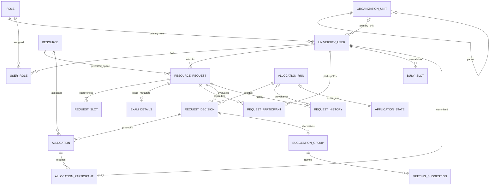

# Iteration 41 - PostgreSQL application persistence

## Boundary and authority

PostgreSQL replaces operational CSV inputs, config.txt, and the published local
engine-result.json. Flask application services own transactions. The existing
C++17 engine, EngineGateway, executable verification, and JSON protocol v1 remain
unchanged. CSV is an explicit import/export or standalone CLI compatibility tool,
not a database fallback or a second writable application store.

## Tables

| Table | Important columns and relationships |
|---|---|
| role | Integer PK; unique name. Primary engine roles remain Student, TeachingAssistant, Staff, Instructor, Administrator. Assigned role labels are preserved, not new priority policies. |
| organization_unit | Integer PK; unique name; nullable type and self-referencing parent FK. Unknown hierarchy/type remains unknown instead of inferred from display names. |
| university_user | Integer PK; primary role FK and nullable primary unit FK; name, email, status and current profile fields. No password or authentication is introduced in this iteration. |
| user_role | Composite user/role PK; assignment ordinal. Preserves assignedRoles order. |
| resource | Integer PK; unique source ordinal; type, name, capacity, building, three feature booleans and availability. |
| resource_request | Integer PK; generated submission ordinal; requester/resource FKs; type, title, purpose, count, feature/building requirements and revision. |
| request_slot | Composite request/ordinal PK; weekday, start/end minutes. Recurring requests retain their ordered occurrence list. |
| exam_details | Request PK/FK; course code/name, exam type, can-split flag. |
| request_participant | Request/user composite PK and unique per-request ordinal; participant role label. |
| busy_slot | Integer PK; user FK, source ordinal, weekday, minutes, reason. |
| application_state | Singleton PK 1; selected strategy, input revision, nullable active-run FK. |
| allocation_run | Generated bigint PK; unique JSON run ID; captured input revision, strategy, status, immutable JSON input snapshot, build metadata and failure explanation. |
| request_decision | Composite run/request PK; status, reason and immutable structured decision payload including engine lifecycle history. |
| allocation | Database PK; run-local allocation ID unique within run; decision/resource FKs; weekday/minutes and assigned count. |
| allocation_participant | Allocation/user composite PK; mandatory human commitments returned by the engine. |
| suggestion_group | Composite decision FK/PK. An empty group preserves "scan found no alternative", distinct from no scan. |
| meeting_suggestion | Group FK; rank, resource FK, slot, score, distances, conflict count and reason. |
| request_history | Integer PK; request FK, optional run FK, event kind/text, timestamp. Application save/import events and run decisions retain their provenance. |

Entity IDs sent to protocol v1 are positive signed 32-bit integers. Run IDs and
database-only allocation/history identifiers are not engine entity IDs. Primary
and foreign keys prevent ambiguous references; CHECK constraints validate types,
positive counts and half-open weekday intervals; UNIQUE constraints prevent
duplicate participants and repeated per-run allocation IDs. Foreign-key and
run/request/resource indexes support the current views.

## Time and allocation semantics

Current functionality is a weekly prototype: TimeSlot and protocol v1 have no
calendar dates. This migration preserves those semantics and does not fabricate
term dates or implement appointments. A future calendar iteration will add
bounded weekly patterns and dated occurrences using an approved timezone.
Appointments will have required organizer/professor commitments, optional student
invitations and separate approvals; no placeholder appointment tables are needed
before that use case is implemented.

There is deliberately no blanket exclusion constraint on room allocation rows.
SharedRoomExamBestFitStrategy permits compatible exam sharing and assigns seats
against remaining capacity. Existing C++ rules/strategies remain authoritative;
SQL constraints must not silently impose a different allocation policy.

## Snapshot, concurrency and publication

All input writes briefly lock application_state using SELECT FOR UPDATE, change
the relevant records, and increment input_revision in the same transaction.
Request IDs and submission order use PostgreSQL identities, not MAX(id)+1.
Lock acquisition has a configurable finite timeout.

A run captures a coherent ordered snapshot and creates its run record under this
short lock. C++ executes after committing that transaction, without a global
database lock or open transaction. Publication locks application_state again,
checks the captured revision and refuses stale input. A later completed run cannot
be replaced by an earlier run. Decisions, allocations, participants, suggestions,
history, run status and the active-run pointer commit together. Failed/stale runs
leave the last successful run active. Readers load one repeatable-read snapshot
and one active run, never a mixture of generations.

Save Only commits request/participants/history without allocation. Submit and Run
first commits the request, then executes allocation. If engine execution or
publication fails, the saved request remains pending and previous results remain
visible. An input revision change is a clear retry failure, not an implicit retry
or a partial success.

## CSV mapping and migration

| Existing input | Database destination |
|---|---|
| users.csv | Users, primary/assigned roles, named primary units; preserve profile fields and IDs. |
| spaces.csv | Resources and original file ordering. |
| requests.csv | Requests, ordered slots, exam details and original submission ordering. |
| request_participants.csv | Committee participant mappings and their order. |
| user_busy_slots.csv | Weekly busy slots and reasons. |
| config.txt | Selected strategy; missing/empty/unknown legacy values use the existing greedy fallback. |
| Generated result CSVs/local JSON | Not imported as authoritative results; regenerate using the verified engine. |

The importer validates all files and references before writing, supports dry-run,
and refuses an already populated application. Invalid rows are reported with file
and row information; no silent skipping or invented references. Explicit IDs and
ordinals are preserved, then identity sequences are advanced safely. Import is
one transaction. Re-running is rejected rather than overwriting data. Existing
files are never modified/deleted; no destructive migration is authorized.

Alembic revisions are reviewed and tested against real PostgreSQL. Development
and CI use isolated databases. Connection URLs/secrets come from the environment,
never source control. Ordinary web reads/writes must succeed with the CSV data
directory and local result JSON unavailable after cutover.
