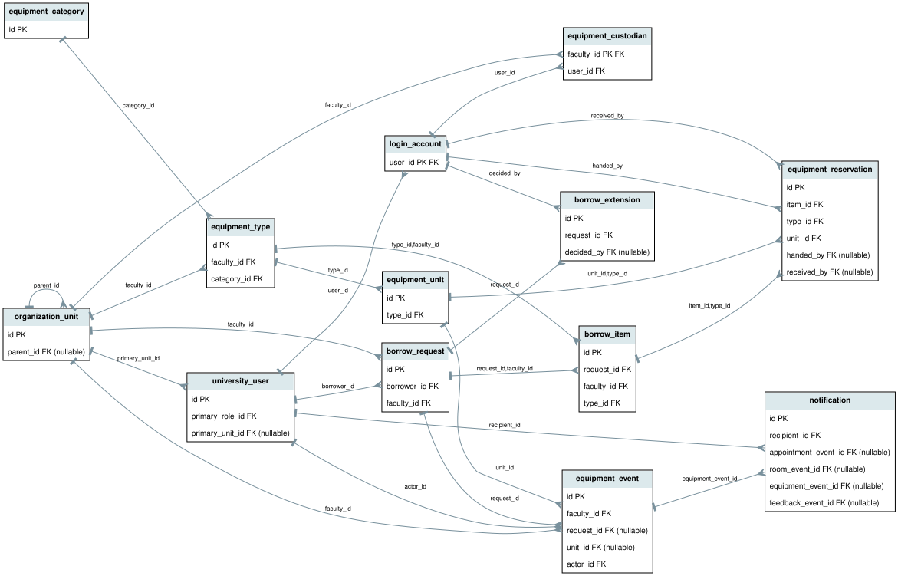

# Equipment borrowing (UC-STU-03)

## Boundary

```text
Authenticated Flask/Jinja -> EquipmentService -> PostgreSQL faculty-scoped transaction
                                      |
                                EngineGateway --equipment-json
                                      |
                        EquipmentMatchingService (C++17, no SQL)
```

Rooms' `Resource`/`Space` capacity and exam-sharing semantics are inappropriate for
returnable assets. Equipment has a separate catalog/type and individually tracked
physical units. Existing users, organizations, login accounts and event inbox are
reused. Room allocation v1, appointments and student rooms remain separate.

## Records and lifecycle



[Mermaid source](equipment-er.mmd) is generated from the actual model foreign keys.
Nine additive tables: `equipment_category`, `equipment_type`, `equipment_unit`,
`equipment_custodian`, `borrow_request`, `borrow_item`, `equipment_reservation`,
`borrow_extension`, `equipment_event`. See the generated physical ER/catalog.
An equipment type belongs to one Faculty; categories are shared labels. The
initial supported owning unit is a configured Faculty, not an inferred department.
Composite foreign keys prohibit mixing faculties/items or types/assets.

`Pending Approval -> Approved -> Borrowed -> Partially Returned -> Returned`.
Pending requests may be rejected; pending or uncollected approved requests may be
cancelled. Approved means reserved, not handed over. Physical inspection records
the actor, timestamps, asset identifiers and conditions. Missing/lost inspection
does not record a physical return. Damaged/maintenance returns release the loan
but leave the unit unallocatable. History remains after cancellation/return.

## Matching and policy

C++ checks ownership, active custodian, enabled type, configured maximum duration,
student eligibility, exact text specifications, usable condition and reservations.
All requested quantities must succeed; no partial reservation or automatic
substitution. Units sort by stable numeric ID. Alternative types must share the
category, satisfy the requested type's specifications and all extra requirements.
Alternative periods start at known reservation ends, within 30 days, with unchanged
duration and all items feasible. Alternatives require an explicit new selection.

Maximum borrowing days are explicitly configured per type (1-365), not a universal
university rule. An empty eligibility list permits students from any faculty;
otherwise their known organizational ancestry must match. No financial penalties.
Date instants are timezone-aware and minute-aligned, displayed in the configurable
university timezone (default Europe/Istanbul); reservations are half-open.

## Concurrency, security and errors

Every inventory/policy/assignment/lifecycle mutation locks its owning faculty row.
The matching subprocess runs inside this bounded transaction so another worker
cannot change that faculty's inventory between snapshot and reservation. Different
faculties remain concurrent. Engine timeout or failure rolls the transaction back.
This deliberately favors correctness over throughput for small faculty inventories.
GiST additionally rejects overlapping unreleased reservations per physical unit.
Deferred aggregate checks enforce quantities and physical-loan lifecycle shape.

Submission locks the borrower identity before the faculty to serialize retries,
with a unique borrower/key and payload fingerprint. Reusing the key with changed
content fails. Approvals use the *current* custodian, not a stale request assignee.
Role/account checks occur in services, and all modifying routes require CSRF.
Students only see their own loans; public catalog availability has no asset tags,
borrower identities or private loan details. Custodians see their assigned faculty.
Administrative assignment does not automatically grant loan-inspection authority.

Unreturned active loans block new allocations even after due dates, including
future recommendations. Existing future reservations are flagged for staff when
an unreturned/overdue or unusable unit threatens pickup; they cannot override the
physical handover check. Overdue alerts refresh on the lending inbox, rather than
introducing a scheduler. A few safe configuration fields remain management forms,
not a generic policy language. No CSV persistence or direct C++ database access.
