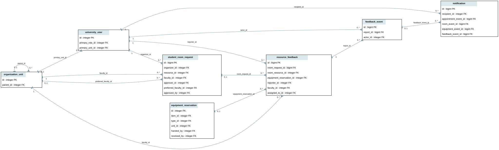

# Resource feedback and issue reporting

## One integration boundary

```text
Room booking / equipment loan -> shared feedback form -> FeedbackService
                                                        |
                                  resource_feedback + feedback_event
                                                        |
                                   existing Notification receipts
                                                        |
                                  private reporter / staff screens

Authorized maintenance -> existing room/equipment services
                         + report audit in the same transaction
                         + existing availability/waiting-list hooks
```

One service, blueprint, form and lifecycle serve both resource kinds. Existing
authentication, users, faculties, ownership, bookings, loans, notifications and
Jinja components are reused. C++ and every JSON v1 operation remain unchanged:
feedback management is not another allocation algorithm or conflict checker.

## Actual use and group membership

Room reports require a confirmed reservation whose start has arrived. During use,
only problems qualify; at the half-open end boundary all categories are available.
The organizer and explicitly recorded current-revision participants qualify, not
an estimated attendee count or an unanswered/declined professor invitation.

Student registration extends `RoomInvitation`, not another membership table.
The organizer explicitly selects students; registered members have Accepted
participation. Database checks preserve role, revision and non-organizer identity.
Professor invitations keep their existing response workflow. Registered students
receive booking access/updates, not exclusive personal-calendar reservations.
The deferred room aggregate also ensures declared attendees include the organizer
and every recorded participant; capacity selection remains in C++.
Room details and waiting-list revalidation reuse the same participant partition,
so a student group remains eligible for pre-approval and automatic room assignment.

Equipment reports select an actual `EquipmentReservation`, with a recorded
physical handover and the authenticated borrower. Unreturned units allow problems;
general feedback/improvements require that specific unit's verified physical
return. Approval, return intent, due dates or another unit's return are insufficient.
No unsupported equipment group-membership association is invented.

## Data and transactions



[Mermaid source](feedback-er.mmd). Migration `0048a` on `0047a` adds two tables
(50 application tables total) and a fourth optional notification event source.

| Record | Responsibility |
|---|---|
| `resource_feedback` | Exactly one room request/resource/revision or physical equipment reservation; immutable reporter/original text/category/retry identity; faculty, assigned staff, current status/priority/response and timestamps. |
| `feedback_event` | Private actor/time/status/revision history, complete responses and clarifications, unique action identity/fingerprint. |
| `notification` (reused) | Exactly one appointment/room/equipment/feedback event, unique recipient receipt and durable read state. |

NO ACTION foreign keys preserve history. Checks validate source shape, text,
states and identities. An insertion trigger verifies the actual usage association;
updates cannot rewrite the original submission or attach it to another booking.

Submission takes a shared usage-row lock before serializing new identities on the
reporter, matching booking parent/user foreign-key lock order. It checks saved
retries before eligibility and rechecks after locking the reporter. Updates lock
the report, verify its revision and deduplicate
action identities. Shared staff-assignment locks prevent reassignment overtaking
a write. Report, event and notification commit together or roll back completely.
Reporter serialization uses PostgreSQL NO KEY UPDATE, compatible with user foreign
key references, so authority updates cannot invert that lock with submission.

## Lifecycle and privacy

`Submitted -> Under Review -> Resolved / Closed`; reopening returns to Under
Review with an explanation. Staff may reprioritize/respond while reviewing.
Reporters may clarify open reports, not resolve them on behalf of staff. Decisions
and reopening require nonempty responses; original content and history remain.

Queries permit only the reporter and current responsible faculty room manager or
equipment custodian. General administration is not an implicit private-report
grant. Staff replacement revokes old access, including old notification receipts;
new staff see their managed inbox. Reporter history remains readable if the
faculty temporarily has no active responsible person; writes require valid routing.
The current owning-faculty manager also has read-only booking context access after
replacement. This does not grant a new approval or cancellation permission.

Separate feedback events are necessary: broadcasting report content through room
or loan history would disclose it to other participants. Notifications use generic
previews and authorized detail links. Private history records actors, recipients
and times. Text is HTML-escaped; state changes require existing authentication and
CSRF. Feedback screens are private/no-store.

## Safety and limits

Urgent problems record priority and show immediate staff-contact guidance. This is
not an emergency service. Reporting never changes availability automatically.
Staff use existing maintenance controls: room managers may close/reopen their own
faculty's rooms; ownership/policy/approver changes remain administration-only.
Existing closure/publication interlocks require explicit cancellation of conflicting
confirmed bookings, never silent displacement. Equipment damage never implies return.

Existing maintenance transactions add actor/time events to affected open reports.
Only availability facts are shared there; free-text maintenance notes remain in
their original staff-authorized record, not other reporters' histories.
A failed private audit/notification rolls back maintenance. Repair/reopening keeps
existing waiting-list refresh behavior; no promotion logic is duplicated.

Own/managed inboxes filter by status/category/service/resource and display the
latest 200 matches. Per-report history is retained without automatic purging.
Reports retain the faculty recorded for the original use; automatic cross-faculty
case transfers require a separate ownership/transfer policy.
There are no attachments, public ratings, anonymous reports, external messages or
automatic penalties. See [requirements](../srs/UC-STU-06-requirements.md).
