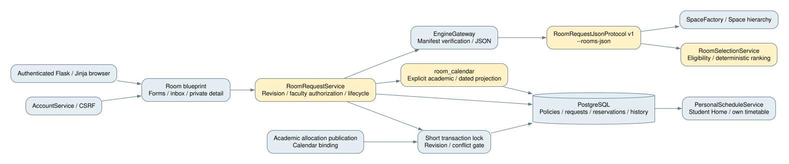

# Student-initiated room allocation (UC-STU-02)

## Responsibilities

[Editable component source](student-room-components.mmd)

The authenticated student describes a purpose, dated interval, total attendance,
facilities and optional preferences, rather than naming a mandatory room.
A separate C++ room-selection operation owns eligibility, conflicts and deterministic
single-room recommendations. Existing weekly allocation strategies and appointment
JSON operations remain compatible. Flask owns authentication, faculty authorization,
request revisions, invitations and transactional publication; PostgreSQL is authoritative.

`RoomRequestService` coordinates these workflows. `RoomSelectionService` evaluates
the engine DTO. `room_calendar` projects known academic bindings and dated reservations.
`EngineGateway` keeps executable freshness and transport validation. Thin room routes
and Jinja pages reuse existing session/CSRF, selection and timetable conventions.

## Policy and ownership

An explicit room policy identifies exactly one owning faculty, supported activity
categories and any user whitelist. Unconfigured rooms are not student-bookable.
A faculty designation identifies its current trusted approver; inactive or missing
accounts cannot approve. Faculty preference is not an access grant and does not
implicitly constrain the search to the student's faculty. Club affiliation is
declared, not verified membership. Existing resources are never assigned invented owners.

## Calendar and concurrency

Dates use configurable Europe/Istanbul and half-open intervals. Academic room
allocations require explicit validity/planning-week bindings; unknown applicability
excludes the room rather than treating it as free. Student reservations are exclusive,
without adding an academic room-overlap constraint that would break shared exams.

Engine evaluation occurs outside write transactions. Confirmation checks calendar
and request revisions under the existing short state-row lock, then records the
approved room and organizer commitments atomically. The room exclusion constraint
prevents competing reservations. Publication of later academic runs and calendar
binding changes uses the same lock and rejects conflicts with confirmed reservations;
it never replaces known-good results with an incompatible schedule.

## Lifecycle and privacy

Pending Faculty Approval reserves nothing. Confirmation requires the current designated
approver and fresh engine validation of the exact selected room. Stale candidates
become Needs Revision, not a silent room substitution. Material revisions clear approval
and reset invitations. Confirmed events use cancellation plus a new request to change
material fields. Cancellation releases commitments but retains history.

Optional professor invitations do not veto room approval. RSVP acceptance checks
the professor's known commitments but does not override or exclusively reserve their
calendar. Authorized participants see invitation/status history; unrelated users receive
only free/busy information, never private purposes or participant identities.

## Delivery

The authenticated `/rooms/` inbox presents organizer, assigned-faculty and invitee
updates. `/rooms/new` gathers needs and automatically reviews ranked candidates;
`/rooms/<id>` exposes revision-specific actions and history. `/rooms/configuration`
is a trusted university-administration configuration screen. Permitted free/busy
at `/rooms/availability/<id>` contains no private event title or participant.
Student Home and the shared personal timetable include confirmed organizer bookings;
accepted professor attendance is distinctly optional. These in-app status/history
views are notifications, not email or push delivery.

The single-machine application keeps short calendar-state serialization for
publication/confirmation, without holding a transaction during engine computation.
Full-batch academic projections and list/detail queries suit the demonstration
scale, not an unbounded production scheduling workload. Authentication deployment
hardening and email remain outside this use case. Existing unconfigured resources
need explicit policy setup; no migration guesses an owning faculty or term dates.

UC-STU-05 adds an optional [shared waiting-list coordinator](waiting-lists-design.md)
for unavailable eligible requests. It reuses this engine and reservation helpers;
pre-approval covers compatible rooms only in the selected owning faculty. Unlike
ordinary room evaluation, promotion holds the existing calendar lock through its
bounded final engine evaluation to keep selection and reservation atomic.
