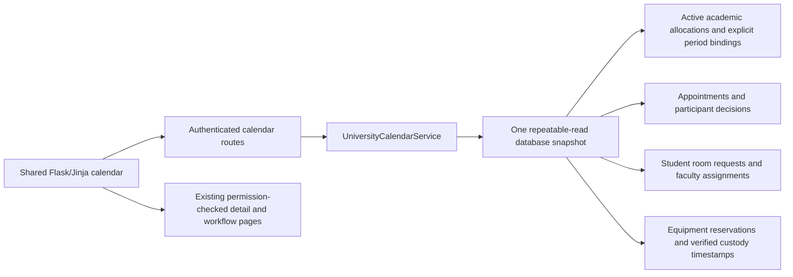

# Unified university calendar

## Boundaries

The calendar is a read-only projection of PostgreSQL records, not a second booking
store. Existing services retain appointment approvals, room reservations, physical
equipment custody, cancellation and conflict checking. C++ strategies and the
versioned engine protocols are unchanged.

## Sources and visibility

| Source | Personal visibility | Additional authorized visibility |
|---|---|---|
| Appointments | Organizer, required professor or invited student | No unrelated administrator bypass |
| Student rooms | Organizer or invited professor | Current assigned faculty approver |
| Equipment | Borrower only | Current enabled, active authorized faculty custodian |
| Academic allocations | Known requester/committee identities; never anonymous attendee counts | Explicitly published academic metadata |
| Weekly busy slots / dated personal blocks | Own identity only | Never part of the public academic schedule |

Academic data has no enrollment model or existing publication policy. Two additive
request fields support explicit administrator publication and an optional known
instructor. Existing records remain private. Committee meetings cannot be published.
Publication reveals scheduling metadata only, never private request purposes,
participant lists, student profiles or audit deliveries. Instructor selection is
explicit and limited to active professors; no teaching/enrollment relationships are
invented. An academic calendar entry does not imply student enrollment.

## Calendar semantics

- Dated appointments and room requests retain their authoritative statuses. A past
  confirmed activity may be labeled completed for display without mutating its status.
- Pending, declined, cancelled and optional activities are distinguishable from
  confirmed mandatory commitments. A manager's activity is not their personal busy time.
- Equipment pickup, due and physically verified handover/return are point reminders.
  They never reserve participant time. Overdue loans remain outstanding until verified return.
- Calendar expansion reuses explicit academic periods, planning weeks, exceptions
  and the configured university timezone. Unresolved legacy dates produce a visible
  warning; the calendar never invents dates or claims complete availability.
- Each response reads one coherent snapshot, including the active allocation run.
  Views are bounded to a day, week or padded month; filters are validated server-side.
- Detail links recheck existing service permissions. Calendar responses are not cached.

## Implementation plan

1. Add publication metadata with a non-destructive Alembic migration and privacy constraints.
2. Project sources into a shared display-only event representation with stable IDs.
3. Add responsive month/week/day navigation, category/status/scope filters and existing detail links.
4. Verify role/privacy boundaries, updates, recurrence, half-open intervals and equipment reminders.
5. Run full regressions, review diagrams, document actual evidence and publish a draft PR.
