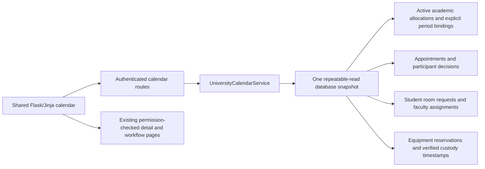

# Unified university calendar

## Boundaries

The calendar is a read-only projection of PostgreSQL records, not a second booking
store. Existing services retain appointment approvals, room reservations, physical
equipment custody, cancellation and conflict checking. C++ strategies and the
versioned engine protocols are unchanged.

## Sources and visibility

| Source | Personal visibility | Additional authorized visibility |
|---|---|---|
| Appointments | Organizer, required professor or invited student | No unrelated administrator bypass |
| Student rooms | Organizer or invited professor | Current assigned faculty approver |
| Equipment | Borrower only | Current enabled, active authorized faculty custodian |
| Academic allocations | Known requester/committee identities; never anonymous attendee counts | Explicitly published academic metadata |
| Weekly busy slots / dated personal blocks | Own identity only | Never part of the public academic schedule |

Academic data has no enrollment model or existing publication policy. Two additive
request fields support explicit administrator publication and an optional known
instructor. Existing records remain private. Committee meetings cannot be published.
Publication reveals scheduling metadata only, never private request purposes,
participant lists, student profiles or audit deliveries. Instructor selection is
explicit and limited to active professors; no teaching/enrollment relationships are
invented. An academic calendar entry does not imply student enrollment.

## Calendar semantics

- Dated appointments and room requests retain their authoritative statuses. A past
  confirmed activity may be labeled completed for display without mutating its status.
- Pending, declined, cancelled and optional activities are distinguishable from
  confirmed mandatory commitments. A manager's activity is not their personal busy time.
- Equipment pickup, due and physically verified handover/return are point reminders.
  They never reserve participant time. Overdue loans remain outstanding until verified return.
- Calendar expansion reuses explicit academic periods, planning weeks, exceptions
  and the configured university timezone. Unresolved legacy dates produce a visible
  warning; the calendar never invents dates or claims complete availability.
- Each response reads one coherent snapshot, including the active allocation run.
  Views are bounded to a day, week or padded month; filters are validated server-side.
- Detail links recheck existing service permissions. Calendar responses are not cached.

## Integration sequence

1. Add publication metadata with a non-destructive Alembic migration and privacy constraints.
2. Project sources into a shared display-only event representation with stable IDs.
3. Add responsive month/week/day navigation, category/status/scope filters and existing detail links.
4. Verify role/privacy boundaries, updates, recurrence, half-open intervals and equipment reminders.
5. Run full regressions, review diagrams, document actual evidence and publish a draft PR.

Verification: 21 new calendar regressions cover private/role visibility, explicit
publication, cancelled/declined invitation precedence, bounded recurrence and
exceptions, timezone/day/hour boundaries, physical equipment reminders, rescheduling
and consistent snapshots during concurrent cancellation. They are included in the
314-test Python suite (313 passed, one POSIX-only skip on Windows). Fresh C++ tests
passed 172/172; additional Flask smoke passed 27/27 and isolated CLI smoke 2/2.
The [iteration report](../iteration-reports/Iteration_45.pdf) records browser and
migration verification, including preservation of all preexisting primary records.

## Components and routes

`UniversityCalendarService` owns permission-scoped read projections and canonical
display events: stable source ID, category, title, zoned start/end, original and
display status, detail URL, location, explanation and personal-commitment marker.
It does not decide availability. `selection` provides bounded view/navigation dates;
`expand_weekly` remains the shared explicit-period projection. Monthly mobile views
become a dated agenda; weekly/daily grids retain exact times and horizontal scroll.
No third-party calendar framework or client-side private-data filtering is needed.

`/calendar/` accepts view/date, validated categories/statuses and audience. Identity
always comes from the signed-in account, never a query parameter. `/calendar/academic/<id>`
returns scheduling metadata only after its own authorization check. `/calendar/publications`
is an administrator-only CSRF-protected operation. Publication is audited; optional
instructor metadata does not alter C++ input or commit someone to an event.

Equipment and notification workflows share `equipment_access` with the calendar,
so disabled or replaced custodians cannot retain calendar management scope.
Appointment and room details continue to use their own service authorization.
General room availability remains in the existing room-selection workflow; the
personal calendar does not broadcast other organizers' private room activities.
The calendar restricts room review visibility to the currently authorized assigned
approver; replacing the faculty assignment does not silently reassign old requests.

## Limits

- There is no course enrollment model. Personal academic events use known requesters
  and committee identities, plus users' own weekly busy slots. Published schedules
  are an explicit separate audience, not proof of attendance.
- A professor label is presentation metadata only; teaching commitments must already
  exist as known participant/busy-slot records. It must not be used to bypass the
  authoritative scheduling services.
- The active academic run is projected, not old historical runs. Pending academic
  batches have no invented dates; dated appointment/room/equipment requests can be
  shown pending without reserving anything.
- At most 5,000 entries are rendered; larger views fail clearly and request narrower
  filters. The UI reads fresh authoritative data on navigation/refresh, not push updates.
- No availability inference, calendar synchronization provider, enrollment system,
  automatic completion transition or allocation benchmarking is introduced.
