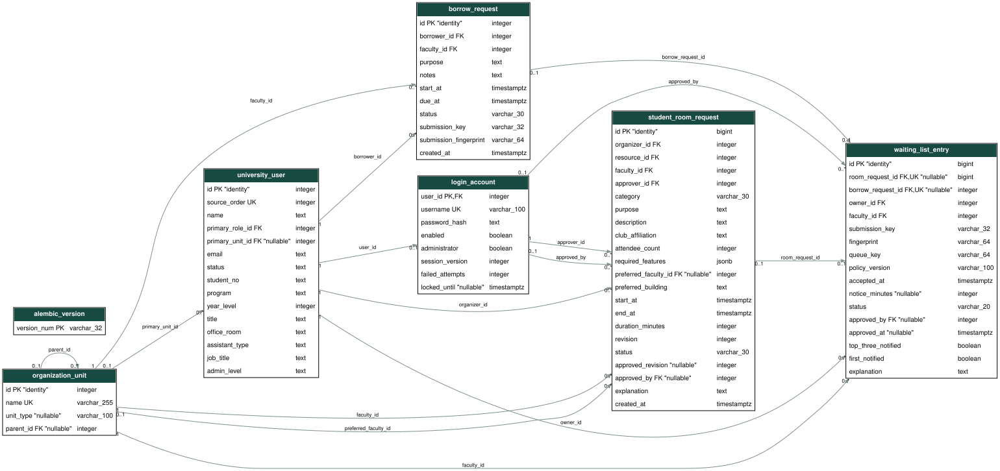

# Resource waiting lists (UC-STU-05)

## Reuse boundary

```text
Existing room / equipment forms -> WaitingListService -> PostgreSQL
                                  |                 (one queue-entry table)
                                  +-> RoomRequestService / EquipmentService
                                         |                 |
                                   existing snapshots -> EngineGateway -> C++
                                         |
                                existing reservation helpers
                                         |
                                existing events + notifications
```

No second booking system, matching algorithm, notification inbox or editable
calendar is introduced. `RoomSelectionService` and `EquipmentMatchingService`
remain authoritative through their unchanged version-1 JSON operations. Academic
allocation's five strategies and appointments are unchanged. C++ has no SQL access.

`WaitingListService` coordinates consent, staff review, FCFS, positions and
transactional promotion. `waiting_list_state` provides small guards, event reuse
and post-commit refresh hooks shared by existing lifecycle services. Thin waiting
routes and shared Jinja components preserve authenticated identity and CSRF.

## Persistence and lifecycle



[Physical Mermaid source](waiting-list-er.mmd). Migration `0047a` adds exactly one
application table (`waiting_list_entry`) and a nullable explicit advance-notice
setting in `application_state`: 48 application tables, plus Alembic infrastructure.

Each entry links to **exactly one** existing student room request or borrowing
request. Original requests own requirements, invitations, dates, quantities,
reservations and history. Queue metadata records the student/faculty, policy
version, consent timestamp, submission identity/fingerprint, contextual queue key,
review decision/actor/time and one-time position milestones. Parent identity and
faculty consistency are checked by deferred PostgreSQL triggers. Active queues
must retain unreserved pending parents. Existing reservation/exclusion/aggregate
constraints are reused. Foreign keys prohibit implicit cascading data loss.

```text
Pending Review -> Preapproved -> Assigned
       |              |
       +-> Rejected   +-> Pending Review (responsible authority changes)
       +--------------+-> Cancelled / Expired / Ineligible
```

Assigned means the original room request is Confirmed or equipment request is
Approved/reserved. Physical handover is still separate. Later cancellation,
handover, extension and verified return use the original services; the historical
queue assignment is retained. Material changes while waiting require cancellation
and a new consented request, not reuse of old approval. Normal approval/revision
paths cannot bypass an active queue.

Joining requires unavailable but eligible requirements, current policy consent
and responsible faculty configuration. Room eligibility evaluates hypothetical
physical availability using the existing C++ rules, while preserving access,
capacity, facilities, resolved academic dates and organizer constraints. Final
evaluation always restores actual room availability/occupancy. Equipment already
distinguishes policy ineligibility from insufficient usable/unheld inventory.

## Authority, fair ordering and notice

Room waiting consent names one owning faculty, not a fixed room. Its approver may
pre-authorize any compatible room **in that faculty only**. Another faculty can
never be substituted under that approval. Equipment retains its existing
single-faculty, complete-quantity request. Mandatory requirements and dates never
change automatically. A valid stored pre-approver must still be the current
authorized staff member at assignment; replacement requires fresh review.

Processing uses stable database join IDs in FCFS order. Pending requests hold
nothing. An earlier request that is not fulfillable in full does not block a
different feasible request. Existing student-room and borrowing workflows define
no separate queue priority tiers; no new priorities are invented.

Displayed positions are **contextual**, grouping resource kind, owning faculty,
exact interval and mandatory needs (including equipment quantities/specifications).
Different or overlapping compatible queues can compete, so positions do not
promise global exclusivity or fulfillment. Pending-review position is estimated;
eligible position counts pre-approved entries with adequate configured notice.
Cancelled/rejected/expired/ineligible/assigned entries have no active position.

There is **no default minimum notice**. Administration must explicitly configure
positive minutes before automatic assignment is enabled. An entry never uses
less than the larger minimum already recorded for it. Insufficient notice pauses
assignment, rather than silently creating a last-minute booking. Unassigned
entries expire at their requested start; no guessed university penalty or no-show
ban is implemented. A changed policy version requires new explicit consent.

## Transactions, refresh and recovery

Room promotion uses the same calendar-state lock as existing room confirmation
and academic publication. Equipment uses the existing owning-faculty row lock.
Equipment queue operations first take a shared state-row lock, so a concurrent
notice-policy update cannot overtake final matching/confirmation. Shared locks
allow equipment faculties to process concurrently; lock order is state, then
identity when needed for submission retries, then faculty. Policy updates use
the existing exclusive state lock.
Matching and reservation occur under those locks, followed by existing database
overlap and aggregate constraints. Concurrent processors cannot confirm twice or
over-allocate. Join keys/fingerprints make unchanged retries idempotent; changed
payload reuse fails. Consent, parent, queue, history, reservations and notification
receipts commit together. An engine/constraint failure rolls back promotion.

Cancellation, verified equipment returns, inventory repairs/additions, faculty
policy/authority changes, room reopening and notice configuration request refresh
**after** their own successful commit. Academic result publication also rechecks
room queues after publication. A refresh failure is logged, not misrepresented as
a failed physical return/cancellation/publication; waiting entries remain retryable.
Due dates and return intent never imply physical availability.

Withdrawing or rejecting a waiting entry also commits its terminal status and
position update before refreshing the remaining queue. An unrelated engine
outage cannot undo that cancellation or rejection. Final assignment and its
notifications remain one separate atomic transaction.

The waiting inbox refreshes authorized scopes. Staff can explicitly recheck there.
`python scripts/process_waiting_lists.py [--kind room|equipment]` supports periodic
maintenance/expiry or recovery after a worker interruption. An operating-system
timer may invoke it; no broker, distributed queue or new web service is needed.
There is no durable background scheduler/outbox: a crash between a release commit
and refresh delays promotion until the next inbox/release/maintenance pass. A
refresh cannot publish a partial reservation. Direct external SQL maintenance
must be followed by this explicit refresh.

Processing remains suitable for the existing single-machine demonstration scale:
room queues share the existing calendar serialization, and a faculty pass runs
bounded engine calls sequentially. It is not a claim of high-volume scheduling
throughput or cross-faculty global queue positions.

## Privacy and notifications

Students see only their own queue details. Current owning-faculty staff see
authorized applicants and actor/time history. Optional professor invitees do not
see private queue positions or consent details; they receive normal room-event
notification when assignment creates their confirmed invitation context.

The existing room/equipment event tables and notification receipts are reused.
Joining, review, cancellation/expiry and assignment are recorded. First eligible
top-three entry and reaching one have durable per-entry flags, updated in the
same transaction as their notifications; ordinary position movement does not
spam the inbox. Automated assignment records its pre-approved responsible actor
and explicitly describes the automatic action. No extra acceptance step follows.

See the [acceptance case matrix](../testing/waiting-list-test-cases.md) for the
expected cancellation, notification, failure, eligibility and competing-worker
outcomes covered by the regression suite.
