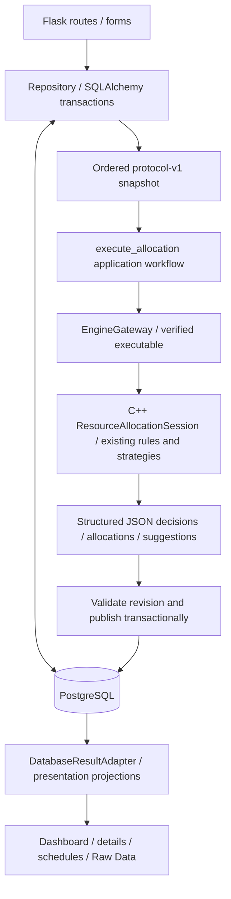

# Iteration 41 - PostgreSQL Application Persistence

**Goal:** Replace operational CSV/config/result-file persistence with PostgreSQL
while preserving the existing C++ engine, JSON protocol v1 and web workflows.

**Behavior delivered:** SQLAlchemy/psycopg repositories and Alembic migrations
store users/roles/units, resources, ordered requests/occurrences/exam metadata,
committee participants, busy slots, allocation runs/decisions/allocations,
structured suggestions, history and strategy configuration. Validated CSV import
preserves IDs and order, supports dry-run and refuses populated targets. Save Only
and Submit and Run keep their existing intent; failures retain saved requests and
previous published results. Dashboard, details, schedules and technical views now
read PostgreSQL, with no file fallback. Standalone C++ CSV mode remains available.

**Architecture and rationale:** PostgreSQL owns persistence; C++ owns allocation.
The repository builds domain DTOs directly from ordered relational records.
`EngineGateway` and executable hash verification are unchanged. Short state-row
locks plus input revision checks avoid holding a global lock during C++ execution.
Validated results and the active-run reference commit together. Readers pin one
repeatable-read view. A blanket room-overlap constraint is intentionally avoided
because compatible exams can share classroom capacity.

The Repository is a focused persistence boundary, not a generic framework.
`DatabaseResultAdapter` reuses existing Adapter/presentation behavior. Existing
Strategy, factories, facades and domain polymorphism remain unchanged; no new
allocation pattern was introduced just for documentation.

**Important locations:** `web/persistence/`, `web/allocation_workflow.py`,
`web/database_result_adapter.py`, `web/app.py`, `migrations/`,
`scripts/import_csv.py`, PostgreSQL tests and the updated Linux CI service.
See [ER diagram and constraints](../architecture/database-design.md),
[operations](../database-operations.md) and [progress/commit record](Iteration_41_progress.md).

**Verification:** Fresh real PostgreSQL 17.11 schemas; original dataset exact
round-trip (9 users, 9 resources, 14 requests, 6 busy slots, 13 participant mappings),
rollback, referential integrity, thread/process saves, worker termination, lock
timeout, failed/stale publication, coherent readers and all five strategies.
Original CSV-input and database-input JSON results compare exactly, including
allocations and suggestions. Full Windows run: 140 C++ passed, zero failed;
155 Python tests total, 154 passed, zero failed, one POSIX-only skip. Two isolated
CLI smoke scenarios and twelve additional database-backed Flask route checks passed.
A fresh disposable database was migrated and imported through the actual CLI;
`alembic check` found no schema drift. Original
untracked generated CSV hashes are preserved. Linux CI is configured and its
actual remote outcome must be reviewed on the draft PR; browser visual QA was not
performed because layouts/interactions were unchanged (storage explanatory text
was corrected).

**Foundation review:** Reviewed every table's keys, relationships, constraints,
nullability, types, indexes, deletion and normalization. Revisions `0041b`/`0041c`
add validated ordering/scores, ordering uniqueness and FK lookup indexes, then
remove a redundant run-prefix index. Corrupt result projections are rejected;
allocation inserts are batched. Metadata-derived Mermaid sources/catalog and
rendered high-level/complete physical SVGs document all 18 application tables plus
Alembic's existing revision table. No application table, C++ algorithm or protocol
field was added. Runtime CSV coordination/publication was removed; historical
helpers remain only in test fixtures, while standalone CSV CLI/import survives.

**Demo and recovery:** Reproducible fictional seed 41 creates 106 users,
20 resources, six faculty/department units, 120 requests and 12 busy slots.
Large mode has 1,060 users, 200 resources and 1,200 requests. All five real
strategies were tested; no fake approvals are inserted and populated targets are
refused. Real custom-format PostgreSQL dump/restore into a new isolated database
preserved decisions, allocations, suggestions and next IDs; a new Flask process
read the restored results. Valid upgrades retain existing data; invalid old rows
abort upgrades atomically without deletion. Actionlint validated CI locally;
the service-container recovery client path is exercised by the Linux PR checks.

**Final completion corrections:** Full organization forests are validated before
initialization/snapshots; corrupt cycles fail before engine execution. Revision
`0041d` enforces deferred slot/exam/participant subtype integrity, including
concurrent child-edit safety. `0041e` adds unique keyed form retries without new
tables; exact retries reuse one request/history/revision, conflicting reuse returns
409. Twenty completion regressions and four recovery/upgrade tests pass locally.
No allocation algorithm, JSON contract, authentication or appointment change.

**Completion checklist:**
- [x] All 18 application tables audited against live PostgreSQL.
- [x] Complete ER sources, zoomable SVGs and physical catalog generated/checked.
- [x] Integrity, bounded query counts, pool return and atomic publication tested.
- [x] Fictional moderate/large demo inputs and real engine execution verified.
- [x] Normal Flask runtime no longer imports legacy CSV coordination/publication.
- [x] Fresh migration, import/dry-run, sequence continuation and rollback verified.
- [x] Real backup/restore and application restart verified in isolated databases.
- [x] Full C++/Python tests, local CI lint, syntax and dependency checks passed.
- [x] Hierarchy, subtype completeness and keyed submission retries verified.
- [x] Remote Linux CI: 155 Python and 140 C++ passed, zero failures/skips.

The current weekly application's database foundation is locally verified. This
checklist is not a claim of production readiness or future appointment support.

**Draft review:** [PR #2](https://github.com/najib-attar/resource-allocation-system/pull/2)
targets main and remains unmerged. Both the initial
[push check](https://github.com/najib-attar/resource-allocation-system/actions/runs/38308473231)
and [PR check](https://github.com/najib-attar/resource-allocation-system/actions/runs/38308530964)
passed on implementation commit `6aa1d1e`, including real PostgreSQL recovery via
matching container tools. Any later commits must also pass the PR checks before
merge. Human approval remains required; no application deployment occurred.

**Trade-offs and follow-up:** Current weekly scheduling is preserved, not converted
to calendar dates. No authentication or UC-STU-01 is implemented. Generated old
results are retained offline, not imported as trusted decisions. Engine failure
does not roll back a previously saved request; stale publication requires explicit
retry. Exact keyed saves are deduplicated; unkeyed clients and engine runs are not.
Abandoned-run reconciliation and automatic retention need an approved policy;
all records remain retained and active publications are never pruned automatically.
Production authentication, credentials, backup/restore and deployment hardening
remain necessary before public use. No production database was overwritten.
