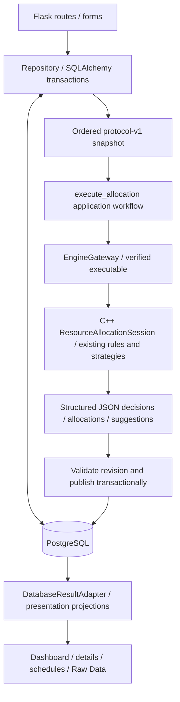

# Iteration 41 - PostgreSQL Application Persistence

**Goal:** Replace operational CSV/config/result-file persistence with PostgreSQL
while preserving the existing C++ engine, JSON protocol v1 and web workflows.

**Behavior delivered:** SQLAlchemy/psycopg repositories and Alembic migrations
store users/roles/units, resources, ordered requests/occurrences/exam metadata,
committee participants, busy slots, allocation runs/decisions/allocations,
structured suggestions, history and strategy configuration. Validated CSV import
preserves IDs and order, supports dry-run and refuses populated targets. Save Only
and Submit and Run keep their existing intent; failures retain saved requests and
previous published results. Dashboard, details, schedules and technical views now
read PostgreSQL, with no file fallback. Standalone C++ CSV mode remains available.

**Architecture and rationale:** PostgreSQL owns persistence; C++ owns allocation.
The repository builds domain DTOs directly from ordered relational records.
`EngineGateway` and executable hash verification are unchanged. Short state-row
locks plus input revision checks avoid holding a global lock during C++ execution.
Validated results and the active-run reference commit together. Readers pin one
repeatable-read view. A blanket room-overlap constraint is intentionally avoided
because compatible exams can share classroom capacity.

The Repository is a focused persistence boundary, not a generic framework.
`DatabaseResultAdapter` reuses existing Adapter/presentation behavior. Existing
Strategy, factories, facades and domain polymorphism remain unchanged; no new
allocation pattern was introduced just for documentation.

**Important locations:** `web/persistence/`, `web/allocation_workflow.py`,
`web/database_result_adapter.py`, `web/app.py`, `migrations/`,
`scripts/import_csv.py`, PostgreSQL tests and the updated Linux CI service.
See [ER diagram and constraints](../architecture/database-design.md),
[operations](../database-operations.md) and [progress/commit record](Iteration_41_progress.md).

**Verification:** Fresh real PostgreSQL 17.11 schemas; original dataset exact
round-trip (9 users, 9 resources, 14 requests, 6 busy slots, 13 participant mappings),
rollback, referential integrity, thread/process saves, worker termination, lock
timeout, failed/stale publication, coherent readers and all five strategies.
Original CSV-input and database-input JSON results compare exactly, including
allocations and suggestions. Full Windows run: 140 C++ passed, zero failed;
113 Python tests total, 112 passed, zero failed, one POSIX-only skip. Two isolated
CLI smoke scenarios and twelve additional database-backed Flask route checks passed.
A fresh disposable database was migrated and imported through the actual CLI;
`alembic check` found no schema drift. Original
untracked generated CSV hashes are preserved. Linux CI is configured but not yet
executed for this unpublished implementation branch; browser visual QA was not
performed because layouts/interactions were unchanged (storage explanatory text
was corrected).

**Trade-offs and follow-up:** Current weekly scheduling is preserved, not converted
to calendar dates. No authentication or UC-STU-01 is implemented. Generated old
results are retained offline, not imported as trusted decisions. Engine failure
does not roll back a previously saved request; stale publication requires explicit
retry. Abandoned run cleanup, retention and idempotent HTTP retry are future work.
Production authentication, credentials, backup/restore and deployment hardening
remain necessary before public use. No production database was overwritten.
