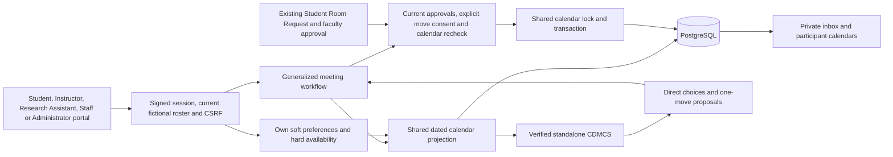
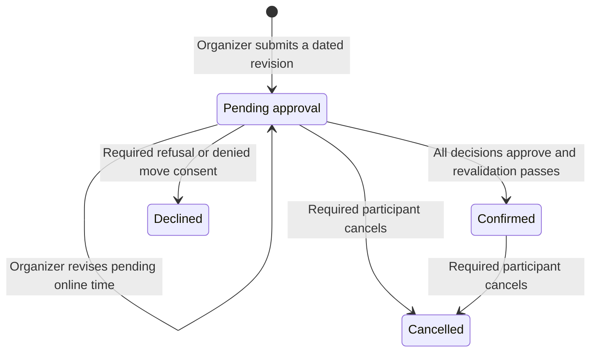

# Generalized meeting pilot architecture

The pilot extends Campus Space with revisioned group meetings in the
opt-in synthetic İTÜ environment. It uses the same account, calendar,
room approval, and inbox records as the rest of the application. The
standalone CDMCS executable ranks choices. The meeting service confirms
bookings only after it rechecks the proposal and records all current
decisions inside a PostgreSQL transaction. The regular scheduler
continues to handle ordinary appointments.

## Application boundaries

The meeting's organizer is accountable for the current request. Required
hosts and guests share the same conflict rules. Their two sides express
one-to-one, one-to-many, many-to-one, or many-to-many relationships.
Optional invitees can respond without reserving their calendars. Duration
is 15 to 120 minutes in 15-minute steps within the owned fictional
fixture's dates.

Calendar projection combines published teaching, confirmed bookings, and
personal blocks. Users publish separate hard weekly windows for the pilot.
An empty hard window leaves the user unavailable for proposed times.
Preferred weekdays and hours and desired gaps contribute to the modeled
cost through the private preference contract. Relocation opt-in lets a
confirmed flexible online meeting be considered for a move. Each actual
move still requires explicit consent.

## Pilot permission matrix

All actions require one of the provisioned, active fictional identities
and an authenticated session on the disposable pilot database.

| Fictional identity | Start as organizer and select participants | Respond as a member | Physical booking authority |
| --- | --- | --- | --- |
| Student | May organize under their own identity | May respond within their assigned membership | May attach their own approved one-time room request |
| Instructor | May organize under their own identity | May respond within their assigned membership | May attend a meeting whose organizer has an approved room |
| Research Assistant | May organize under their own identity | May respond within their assigned membership | May attend a meeting whose organizer has an approved room |
| Staff | May organize under their own identity | May respond within their assigned membership | Existing faculty decision permissions require a designated approver assignment |
| Administrator | May organize under their own identity | May respond within their assigned membership | Existing faculty decision permissions require a designated approver assignment |

| Operation | Actor and state |
| --- | --- |
| View a meeting or its updates | A current participant of that meeting, through their private campus inbox or calendar |
| Approve or decline a requested time | Each required participant other than the organizer decides the current revision. Organizing approves the proposed new time for the organizer. |
| Accept or decline an optional invitation | Its optional invitee may respond while the future meeting is pending or confirmed. Their response cannot veto confirmation or create a commitment. |
| Consent to or refuse relocation | Each required participant of the affected meeting decides explicitly. The requesting organizer also needs explicit consent if affected. |
| Cancel | Any required participant may cancel the current future pending or confirmed meeting. A confirmed cancellation releases group commitments. The room booking keeps its existing owner and lifecycle. |
| Propose a different time | The organizer may revise a current pending online meeting. The revision clears earlier required approvals and the move proposal. |
| Manage personal scheduling settings | The owner publishes their own hard availability and updates their own private soft preferences. |

These permissions are available only through the opt-in pilot. Staff and
Administrator roles have no general access to other participants'
meetings, preferences, or approvals.

## Confirmation and relocation

A direct choice must agree with the required calendars. An online
meeting can include a participant-scoped HTTPS join link. A physical
meeting also needs the organizer's own approved Student Room Request in
category Meeting for the exact same interval. Review uses the approved
and present facilities, the approved total headcount, current room
capacity, and the room whitelist when restricted. The room usage
projection checks teaching, academic allocations, closures, and other
reservations. The organizer's already approved linked slot is the only
room commitment excluded from their group feasibility check. No new room
reservation is written by the meeting service. Cancel the group meeting
before releasing its confirmed room through the usual room workflow.

A one-move proposal targets an eligible confirmed flexible online
meeting. The requester must belong to its required set, that set must
be included in the new required set, and each affected person must
opt in and consent to the exact revision. The replacement and new
interval must both be feasible and cannot overlap. The service rechecks
availability, the target revision, all approvals, and both intervals
under the shared calendar lock. It then moves the target, reserves the
new group and writes both sets of notifications in one transaction.
A failed recheck rolls the whole operation back. Refusal preserves the
original reservation. Protected teaching, ordinary confirmed appointments,
and physical group meetings stay fixed.

## Persistence diagram

The [focused Mermaid ER source](../../architecture/group-meeting-er.mmd)
shows six tables introduced by migration `0051f` and the existing room,
user, and inbox relationships. See the
[complete physical diagram](../../architecture/database-er-physical.svg)
and [column and constraint catalog](../../architecture/database-schema-catalog.md).

| Table | Responsibility |
| --- | --- |
| `group_meeting` | Organizer, dates, status, current revision, online link or linked room, and optional move target |
| `group_meeting_participant` | Required host, required guest, or optional invitee and their decision |
| `group_meeting_commitment` | Exact half-open dates reserved for each confirmed required participant |
| `group_meeting_consent` | Per-person decision for a proposed move at the current meeting revision |
| `group_meeting_availability` | Owner-published weekly hard windows, validity dates, and relocation opt-in |
| `group_meeting_event` | Timestamped meeting history and source for recipient-scoped notification records |

The partial unique room index limits an approved request to one active
group meeting. Deferred constraints preserve complete confirmed
commitments and prevent release of a linked confirmed room.
The existing `scheduling_preference_revision` table remains the source
of soft preferences. A populated pilot must be explicitly resolved
before downgrading, preserving its approval and availability history.
